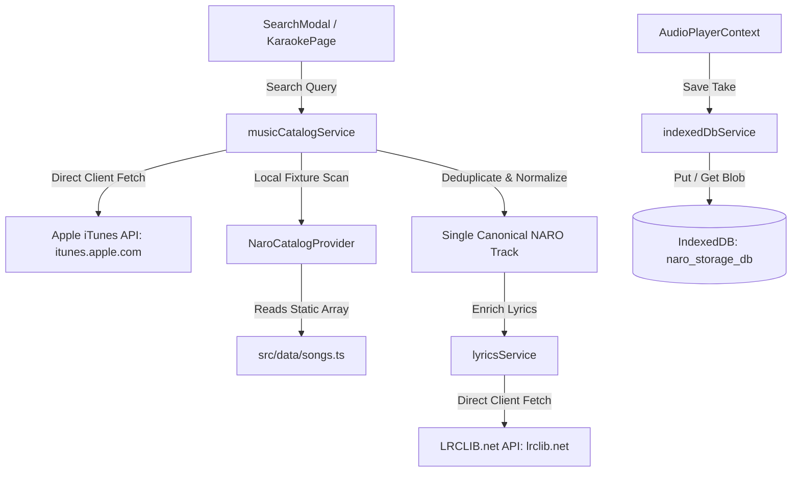
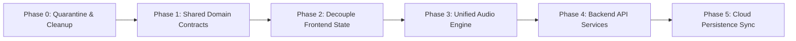

# NARO Architectural Audit & Target Migration Blueprint

> **Status:** Current Architecture Audit & Target System Design  
> **Date:** October 2026  
> **Scope:** Full-stack architecture audit across Playback, Karaoke, Lyrics, Persistence, Audio Assets, and Domain Contracts.  
> **Target:** Incremental transformation from monolithic browser-bound client into clean `frontend`, `backend`, and `shared` tiers.  
> **Invariants:** Preserve all verified behaviors (lyric-first start, unlimited manual recording, real `MediaRecorder`, 65.6s Chrome verification, "Your Take", IndexedDB persistence, truthful `KARAOKE_READY` / `SING_ALONG`, and zero fabricated scoring).

---

## 1. Current Architecture

### 1.1 Architectural Overview

NARO is currently implemented as a single-page application (SPA) built with React 19, TypeScript (~6.0), and Vite 8. It contains **no server-side backend or API gateway**. All domain evaluations, media streaming orchestrations, DSP vocal suppressions, microphone recordings, catalog normalizations, external API integrations, and data persistence happen exclusively within the client's browser runtime.

```
+---------------------------------------------------------------------------------------------------+
|                                      CLIENT BROWSER (SPA)                                         |
|                                                                                                   |
|  +--------------------+   +------------------------------------+   +---------------------------+  |
|  |     Pages & UI     |-->|        AudioPlayerContext          |-->|    Domain & Evaluation    |  |
|  | Home, Discover,    |   |  - Monolithic React Context        |   | - capabilityService       |  |
|  | Karaoke, Library,  |   |  - 49 state properties             |   | - lyricsService           |  |
|  | Downloads, Modals  |   |  - Dual clock arbitration          |   | - musicCatalogService     |  |
|  +--------------------+   +------------------------------------+   +---------------------------+  |
|                                   |                    |                                          |
|            +----------------------+                    +--------------------+                     |
|            v                                                                v                     |
|  +-------------------------------------+                      +--------------------------------+  |
|  |           Playback Engine           |                      |        Karaoke Engine          |  |
|  | - playbackService                   |                      | - karaokePlaybackService       |  |
|  | - Html5AudioPlaybackProvider        |<-------------------->| - karaokeMixer (Web Audio DSP) |  |
|  | - NaroFullLengthPlaybackProvider    |                      | - WebAudioVocalSuppressor      |  |
|  | - AppleMusicPlaybackProvider        |                      | - karaokeSeparationEngine      |  |
|  | - YouTubeIframePlaybackProvider     |                      | - recording/recordingEngine    |  |
|  +-------------------------------------+                      +--------------------------------+  |
|            |                                                                |                     |
|            v                                                                v                     |
|  +--------------------+   +--------------------+   +--------------------+   +------------------+  |
|  | HTMLAudioElements  |   |    Web Audio API   |   |   MediaRecorder    |   |    IndexedDB     |  |
|  | (<audio>, streams) |   | (Gain, Analyser)   |   |  (Microphone Blob) |   | (naro_storage_db)|  |
|  +--------------------+   +--------------------+   +--------------------+   +------------------+  |
+---------------------------------------------------------------------------------------------------+
                                             |
                   External Direct Network Calls (No Server Proxy)
                                             |
        +------------------------------------+-----------------------------------+
        v                                    v                                   v
+-----------------------+          +--------------------+             +--------------------+
|  Apple iTunes Search  |          |    LRCLIB.net      |             |  Apple CDN Scripts |
| (itunes.apple.com)    |          |  (Synced Lyrics)   |             | (MusicKit JS SDK)  |
+-----------------------+          +--------------------+             +--------------------+
```

### 1.2 Subsystem Breakdown

#### A. Playback Subsystem
- **Provider Abstraction:** Defined via `MusicPlaybackProvider` and `ProviderCapabilities` (`src/services/audio/playbackTypes.ts`).
- **Implementations:**
  - `Html5AudioPlaybackProvider`: Streams unencrypted MP3/AAC audio previews and licensed streams directly via standard `HTMLAudioElement`. Intercepts audio output to route into `karaokeMixer` for Web Audio DSP processing.
  - `NaroFullLengthPlaybackProvider`: Specialized HTML5 audio provider for full-length NARO-licensed tracks (`open-license` or `naro-licensed`) and developer fixtures.
  - `AppleMusicPlaybackProvider`: Wraps Apple's `MusicKit JS`. Operates in DRM-restricted EME containers; capabilities explicitly report `supportsWebAudioRouting: false` and `supportsKaraokeProcessing: false`.
  - `YouTubeIframePlaybackProvider`: Controls a hidden 2x2 px YouTube player iframe injected into the DOM body (`<div id="naro-yt-player-slot">`). Does not expose raw audio PCM or Web Audio routing.
- **Clock Authority:** Maintained via `playbackService.subscribeClock()`. Uses high-frequency 50ms polling intervals (`window.setInterval`) supplemented by `timeupdate` DOM events, broadcasting `PlaybackClockEvent` records.

#### B. Karaoke Subsystem
- **Vocal Suppression DSP:** `WebAudioVocalSuppressor` executes real-time center-channel vocal attenuation using phase inversion (`L - R` subtraction via `ChannelSplitterNode`, `GainNode`, and `ChannelMergerNode`), paired with a bandpass filter (250Hz - 4.5kHz) targeting central lead vocal frequencies while preserving low-end bass and stereo width.
- **Mixer Graph:** `karaokeMixer` manages audio routing between background music (BGM), live microphone input, microphone monitoring (disabled by default to avoid acoustic feedback), and master output analysers.
- **Dedicated Backing Source:** When a track provides a verified dedicated instrumental (e.g. `josh-woodward-shot-down-novox.mp3`), `karaokePlaybackService` switches the active stream to the NoVox file without destructive phase cancellation.
- **Real Microphone Recording:** Implemented in `src/services/recording/recordingEngine.ts` using `navigator.mediaDevices.getUserMedia()` and `MediaRecorder` (`audio/webm;codecs=opus` with fallback to `audio/ogg`). There is **no artificial duration cap** (proven through >30s and 65.6s Chrome CDP verification tests).
- **Truthful Status Determination:** Track capability evaluates strictly into `KARAOKE_READY` (unencrypted audio with Web Audio DSP or dedicated backing), `SING_ALONG` (DRM stream where audio cannot be routed through DSP, but live mic and synced lyrics are active), or `UNAVAILABLE`.
- **Performance Review ("Your Take"):** `PerformanceReviewModal` renders recorded moments, providing volume sliders for Music and Voice, re-recording, file downloading, and persistence. Displays "Analysis unavailable" truthfully without fabricated scores or pitch accuracy percentages.

#### C. Lyrics Subsystem
- **Canonical Timeline Model:** Timed lyric lines (`TimedLyricLine`) specify an authoritative start time, duration, line text, and multi-language translations.
- **Deterministic Synchronization:** `getActiveLyricIndex` in `lyricsService.ts` executes a deterministic binary search ($O(\log N)$) against `currentTime`, preventing frame-rate jitter and eliminating false triggers during inter-line pauses.
- **Dynamic Retrieval:** If lyrics are absent from a track model, `lyricsService.fetchLyrics()` makes direct, unproxied client fetch requests to `https://lrclib.net/api/get` and `https://lrclib.net/api/search`.
- **Language Detection & Translation:** `detectLanguage()` detects Unicode scripts (Telugu, Tamil, Malayalam, Devanagari, English). `getLineTranslation()` returns translations strictly when present, otherwise returning an honest `"Translation unavailable"` without fallback language substitution.

#### D. Persistence Subsystem
- **IndexedDB (`indexedDbService.ts`):** Operates on database `naro_storage_db` (v1) with object store `moments`, indexed by `recordedAt` and `songId`. Persists real `Blob` binary audio data alongside take metadata.
- **Browser-Only Storage:** SessionStorage is utilized for transient UI state (e.g. `naro_intro_seen`, `naro_recently_sung`). LocalStorage is utilized for user tokens (`naro_apple_developer_token`, `naro_apple_user_token`). No remote server backup or cross-device profile exists.

#### E. Audio Assets & Fixtures
- **Legitimate Reference Masters:** `public/audio/josh-woodward-shot-down-vocal.mp3` (255s full vocal track, CC-BY 3.0 US) and `public/audio/josh-woodward-shot-down-novox.mp3` (255s dedicated instrumental).
- **Commercial Previews:** 30-second official preview streams dynamically loaded from Apple CDN (`audio-ssl.itunes.apple.com`).
- **Dev Fixtures:** `public/audio/midnight-drive.wav` (17.2MB procedural audio, tagged `playbackSourceType: 'dev-fixture'`).
- **Orphan Synthetic Assets:** `public/audio/channa-mereya-full.wav` (25.5MB obsolete synthetic WAV; zero runtime imports, retained only on disk).
- **Procedural Synthesizer:** `src/services/audioEngine.ts` generates synthetic sine/triangle chord progressions for offline mock tracks (`neeve`, `vennela`, `khaab`).

---

## 2. Responsibility Map

The following map classifies all major modules, identifies their current operational scope, and assigns their definitive architectural layer in the target system:

| Module | Current Responsibility | Classification | Future Layer | Notes |
| :--- | :--- | :--- | :--- | :--- |
| `src/types/music.ts` | Monolithic file containing domain types, capabilities, audio formats, UI state types | Domain Types | **Shared** | Needs splitting into distinct modules (`track`, `lyrics`, `capabilities`, `take`). |
| `src/services/audio/playbackService.ts` | Selects playback providers, orchestrates load/play/seek/pause, broadcasts playhead clock | Service / Audio Controller | **Frontend** | Browser-only. High-level manager of client media playback. |
| `src/services/audio/playbackTypes.ts` | Interfaces for playback providers, clock events, and capabilities | Interface Contracts | **Shared / Frontend** | Clock and provider interfaces split into shared capability contracts and frontend audio interfaces. |
| `src/services/audio/Html5AudioPlaybackProvider.ts` | Controls `<audio>` element for preview and direct audio streaming | Provider Adapter | **Frontend** | Browser-only. Interacts directly with DOM and Web Audio. |
| `src/services/audio/NaroFullLengthPlaybackProvider.ts` | Controls `<audio>` for licensed full-length and dev fixture audio | Provider Adapter | **Frontend** | Browser-only. Manages Web Audio connection and 50ms polling loop. |
| `src/services/audio/AppleMusicPlaybackProvider.ts` | Interfaces with Apple MusicKit JS SDK instance | Provider Adapter | **Frontend** | Browser-only. EME DRM playback; cannot route through Web Audio. |
| `src/services/audio/YouTubeIframePlaybackProvider.ts` | Controls offscreen YouTube iframe and polls video playhead | Provider Adapter | **Frontend** | Browser-only. Injects script and iframe DOM element. |
| `src/services/audio/karaokePlaybackService.ts` | Manages dedicated instrumental streams and coordinates backing playback | Service / Audio Controller | **Frontend** | Browser-only. Tightly coupled to `playbackService` and `audioEngine`. |
| `src/services/audio/karaokeMixer.ts` | Manages Web Audio node graph for BGM, microphone, and vocal suppression | Audio DSP Graph | **Frontend** | Browser-only. AudioContext, GainNodes, AnalyserNodes. |
| `src/services/audio/vocalSeparation/WebAudioVocalSuppressor.ts` | Center-channel phase cancellation DSP filter | Audio DSP Node | **Frontend** | Browser-only. Low-latency client-side DSP. |
| `src/services/audio/vocalSeparation/SpectralChunkSeparator.ts` | In-memory cache and offline buffer processor | DSP Worker / Buffer Cache | **Frontend** | Browser-only. Decodes AudioBuffers; candidates for Web Worker offload. |
| `src/services/audio/vocalSeparation/karaokeSeparationEngine.ts` | Facade for chunk-based separation | Service Facade | **Frontend** | Browser-only. Fetches audio streams to decode AudioBuffers. |
| `src/services/audio/vocalSeparation/separationTypes.ts` | Types for separation engine and chunk processing | Interface Contracts | **Shared / Frontend** | Buffer contracts belong in frontend; job status belongs in shared. |
| `src/services/audioEngine.ts` | Procedural Web Audio synth (sine/triangle oscillator chords) | Procedural Synth / Dev Tool | **Frontend (Dev)** | Browser-only mock engine. Should be quarantined to dev/test fixtures. |
| `src/services/capability/capabilityService.ts` | Evaluates playback, karaoke, and lyrics capabilities for tracks | Domain Service | **Shared** (Logic) / **Frontend** | Pure evaluation logic belongs in Shared; runtime provider capability inspection belongs in Frontend. |
| `src/services/connectivity/connectivityService.ts` | Listens to browser `online`/`offline` events | Browser Adapter | **Frontend** | Browser-only `navigator.onLine` wrapper. |
| `src/services/lyrics/lyricsService.ts` | Fetches LRCLIB, parses LRC, runs binary search active line tracking | Service / Parser | **Backend** (Fetch) / **Frontend** (Sync) | Fetching & caching belongs on Backend; $O(\log N)$ playhead sync belongs on Frontend. |
| `src/services/providers/musicCatalogService.ts` | Aggregates and deduplicates search results from providers | Catalog Aggregator | **Backend** | Runs client-side network calls; should be a server-side catalog aggregation service. |
| `src/services/providers/musicProviderTypes.ts` | Interfaces for catalog providers and search options | Interface Contracts | **Shared** | Service contracts for catalog queries. |
| `src/services/providers/AppleMusicCatalogProvider.ts` | Direct iTunes API search (`itunes.apple.com`) and normalization | Provider Adapter | **Backend** | Backend service candidate. Eliminates browser CORS/rate-limiting fragility. |
| `src/services/providers/appleMusicKitService.ts` | Manages Apple MusicKit script loading and tokens | Client Auth Adapter | **Frontend** (Client SDK) & **Backend** (Token Dispatch) | Token generation/signing must be Backend; user session is Frontend. |
| `src/services/providers/NaroCatalogProvider.ts` | Returns local in-memory songs and dev fixtures | Mock Provider | **Frontend (Dev)** | Dev-only catalog provider. |
| `src/services/providers/YouTubeCatalogProvider.ts` | Stub for YouTube catalog queries | Provider Adapter | **Backend** | Currently empty; requires backend API key integration. |
| `src/services/recording/recordingEngine.ts` | Real microphone capture via `MediaRecorder` | Hardware Adapter | **Frontend** | Browser-only hardware interface (`getUserMedia`). |
| `src/services/recordingEngine.ts` | Legacy recording engine with simulated fallback | Dead Code / Prototype | **Deprecate / Remove** | Deprecated orphan file. Unused by active application code. |
| `src/services/storage/indexedDbService.ts` | Stores and retrieves audio Blobs in IndexedDB | Storage Adapter | **Frontend** (Local) & **Backend** (Cloud Sync) | Blob persistence remains client-side; take metadata synchronizes with Backend. |
| `src/context/AudioPlayerContext.tsx` | Global React state manager (49 props, playback, modals, takes) | UI State Monolith | **Frontend** | Must be refactored into focused, domain-specific stores/hooks. |
| `src/data/songs.ts` | Hardcoded static track metadata, lyrics, and audio signatures | Static Catalog / Fixtures | **Backend** (Seed Data) / **Frontend (Dev)** | Embedded catalog data. Must become a seed database on the backend. |
| `src/data/lyricsFixtures.ts` | Synthetic synced and plain lyric fixtures | Test Fixtures | **Test / Dev** | Must be relocated from `src/` to `tests/fixtures/` to prevent bundle bloat. |
| `src/components/KaraokeModal.tsx` | Lyric-first Karaoke entry, line selection, backing verification | UI Component | **Frontend** | High-level interactive UI modal. |
| `src/components/KaraokeRecordingState.tsx` | Countdown, live recording display, volume sliders, manual stop | UI Component | **Frontend** | Directly controls `recordingEngine` and saves takes. |
| `src/components/PerformanceReviewModal.tsx` | "Your Take" playback, volume mixing, save/delete | UI Component | **Frontend** | Contains business logic (`new Audio()` instances) that must be refactored. |
| `src/components/LyricsDrawer.tsx` | Floating synchronized lyric viewer and language switcher | UI Component | **Frontend** | Auto-scrolls based on authoritative active line index. |
| `src/components/NowPlaying.tsx` | Full-screen expanded player with atmospheric mood and lyrics | UI Component | **Frontend** | 1011-line composite view containing display and state handling. |
| `src/components/BottomPlayer.tsx` | Persistent studio transport player | UI Component | **Frontend** | Controls transport, scrub bar, volume, and drawer toggles. |
| `src/components/SearchModal.tsx` | Global search modal with debounced query execution | UI Component | **Frontend** | Triggers catalog searches; cleanly isolated from playback logic. |
| `src/components/AccountConnectionModal.tsx` | Apple Music credentials entry dialog | UI Component | **Frontend** | Configures developer and user tokens. |
| `src/components/AbstractArtwork.tsx` | Procedural SVG artwork generator based on track palette | UI Presentation | **Frontend** | Pure deterministic visual renderer. |
| `src/components/WaveformTimeline.tsx` | Canvas-based waveform visualization and section selector | UI Presentation | **Frontend** | Interactive scrubbable waveform display. |
| `src/pages/KaraokePage.tsx` | Dedicated Karaoke destination with scoped search & language sections | UI Page View | **Frontend** | Contains custom take audio element playback logic. |
| `src/pages/LibraryPage.tsx` | User collection view (Recorded Takes vs Catalog Songs) | UI Page View | **Frontend** | Instantiates unmanaged `new Audio()` for take playback. |
| `src/pages/DownloadsPage.tsx` | Local offline recordings and downloaded files view | UI Page View | **Frontend** | Direct download trigger using object URLs. |
| `public/audio/*` | Static audio files (reference tracks, dev fixtures, legacy WAV) | Static Media Assets | **Public Asset Storage / CDN** | Needs classification: legitimate reference vs dev fixture vs purge. |

---

## 3. Dependency Map

### 3.1 Audio Control & Playback Flow

The diagram below highlights the tight bidirectional coupling between `AudioPlayerContext`, `playbackService`, and `karaokePlaybackService`:

```mermaid
graph TD
    UI[UI Components: BottomPlayer, KaraokeModal, NowPlaying] -->|Action Calls| APC[AudioPlayerContext]
    
    subgraph Playback Management
        APC -->|loadAndPlay / seek / pause| PS[playbackService]
        PS -->|handleClockEvent| APC
        PS -->|Controls Active Provider| H5P[Html5AudioPlaybackProvider]
        PS -->|Controls Active Provider| NLP[NaroFullLengthPlaybackProvider]
        PS -->|Controls Active Provider| AMP[AppleMusicPlaybackProvider]
        PS -->|Controls Active Provider| YTP[YouTubeIframePlaybackProvider]
    end

    subgraph Karaoke Management
        APC -->|startRecording / stop| KPS[karaokePlaybackService]
        KPS -->|Directly Controls| PS
        PS -->|Subscribes to Karaoke Mode| KM[karaokeMixer]
        KPS -->|subscribeClock| APC
        H5P -->|connectAudioElement| KM
        NLP -->|connectAudioElement| KM
        KM -->|Applies Real-Time DSP| VS[WebAudioVocalSuppressor]
        KRS[KaraokeRecordingState] -->|Controls Hardware| RE[recording/recordingEngine]
        RE -->|Captures PCM Stream| MR[MediaRecorder]
    end

    subgraph Independent Audio Leaks
        PRM[PerformanceReviewModal] -.->|Direct new Audio()| DirectAudio1[Unmanaged Audio Instances]
        LP[LibraryPage] -.->|Direct new Audio()| DirectAudio2[Unmanaged Audio Instances]
        KP[KaraokePage] -.->|Direct new Audio()| DirectAudio3[Unmanaged Audio Instances]
    end
```

### 3.2 Data Ingestion & Catalog Flow



### 3.3 Critical Architectural Tangles Identified

1. **Circular Relationship between Playback and Karaoke Services:**
   - `playbackService.ts` imports `karaokeMixer.ts` and delegates `setKaraokeMode()`, `setBgmVolume()`, and `setVoiceVolume()`.
   - `karaokePlaybackService.ts` imports `playbackService.ts` to coordinate playhead seeking, starting playback, and pausing.
   - `karaokeMixer.ts` relies on HTML audio elements passed from `Html5AudioPlaybackProvider` or `NaroFullLengthPlaybackProvider`.
   - `AudioPlayerContext.tsx` subscribes to both services simultaneously and maintains an internal mutable ref (`isRecordingActiveRef.current`) to arbitrate which service's clock writes to the component state.
2. **Unmanaged Audio Instances in UI Components:**
   - `PerformanceReviewModal.tsx` spawns two independent `new Audio()` instances (`voiceAudioRef` and `backingAudioRef`) inside a `useEffect`, attaching time-update listeners and seeking manually without going through any playback service or audio graph.
   - `LibraryPage.tsx` and `KaraokePage.tsx` spawn ad-hoc `new Audio()` instances to preview recorded takes, completely bypassing the central audio player, spectrum visualizer, and global pause/play controls.
3. **Direct Browser API Calls from Business Logic:**
   - `YouTubeIframePlaybackProvider.ts` manipulates the DOM directly (`document.body.appendChild`) and injects script tags into `document.head`.
   - `appleMusicKitService.ts` accesses `localStorage` directly for authentication credentials.
   - `lyricsService.ts` makes unauthenticated, rate-limit-vulnerable external HTTP calls directly from the browser window.

---

## 4. Architectural Problems (Ranked by Engineering Priority)

### Critical

#### P1: Monolithic State God-Object in `AudioPlayerContext.tsx`
- **Location:** `src/context/AudioPlayerContext.tsx`
- **Description:** The context interface exports 49 properties and methods. It simultaneously manages audio playback, volume levels, dual clock event subscriptions, section looping, active/display languages, native language script detection, modal visibility (NowPlaying, LyricsDrawer, SearchModal, KaraokeModal, PerformanceReviewModal, AccountModal), microphone permissions, recording state, IndexedDB CRUD operations, catalog mutation (`addSongToCatalog`), and global `window.__naro_*` debugging bindings.
- **Consequence:** Any state update (such as 20Hz playhead ticks or volume adjustments) triggers broad component re-renders across the application tree unless wrapped in strict memoization. State boundaries are blurred, making isolated automated testing impossible.

#### P2: Tightly Coupled Dual-Clock Arbitration with Race Conditions
- **Location:** `src/services/audio/playbackService.ts`, `src/services/audio/karaokePlaybackService.ts`, `src/context/AudioPlayerContext.tsx` (lines 158–202)
- **Description:** `playbackService` and `karaokePlaybackService` maintain separate playback clocks and listeners. During Karaoke recording, `AudioPlayerContext` uses a mutable ref (`isRecordingActiveRef.current`) inside separate event listener callbacks to suppress `playbackService` events.
- **Consequence:** If a timing event arrives out of sequence during the transition from countdown to recording, the UI playhead jumps between normal track time and karaoke backing time, causing desynchronization in lyric highlighting and waveform rendering.

#### P3: Audio Engine Business Logic Leaking into React Presentation Components
- **Location:** `src/components/PerformanceReviewModal.tsx` (lines 28–79), `src/pages/LibraryPage.tsx` (lines 28–43), `src/pages/KaraokePage.tsx` (lines 23–24)
- **Description:** Rather than delegating audio playback to a unified audio manager, these components instantiate raw browser `new Audio()` objects, manage event listeners (`timeupdate`, `ended`), control volumes, and synchronize backing and vocal tracks manually within React lifecycle hooks.
- **Consequence:** Audio elements can remain playing in the background if components unmount unexpectedly (e.g. navigation changes). Multiple audio sources can play simultaneously, causing acoustic clashes and memory leaks.

#### P4: Direct Unproxied Third-Party API Calls from the Client Browser
- **Location:** `src/services/providers/AppleMusicCatalogProvider.ts` (lines 30–33), `src/services/lyrics/lyricsService.ts` (lines 375–395)
- **Description:** The client browser directly calls `https://itunes.apple.com` for catalog searches and `https://lrclib.net` for synchronized lyrics without an intermediary backend gateway.
- **Consequence:** 
  1. Client IP addresses are exposed directly to third-party services.
  2. The application is completely vulnerable to third-party rate limits, CORS policy shifts, and API schema breaking changes.
  3. No server-side caching, response normalization, or fallback resilience can be applied across users.

---

### High

#### P5: Duplicated and Conflicting Domain Data Models
- **Location:** `src/types/music.ts`
- **Description:**
  - `LyricLine` vs `TimedLyricLine`: Both define `time`, `duration`, `text`, `words`, `id`, `startTime`, `endTime`, and `translations`.
  - In `Song`, track capability is represented multiple redundant ways: `karaokeReady: boolean`, `karaokeAvailable?: boolean`, `karaokeAvailability?: ...`, and `capabilities.karaoke?: boolean`. Similarly, playback status is represented by `playbackAvailable`, `playbackAvailability`, `playbackType`, `playbackSourceType`, and `capabilities.playback`.
  - `RecordedTake` contains an unused, prototype-era `score?: { overall: number; resonance: number; timing: number; vibe: string }` block that directly contradicts the verified requirement of zero fabricated scoring.
- **Consequence:** Code across the app must check multiple properties to answer a single question (e.g. "Can this song be sung in Karaoke?"), leading to divergence where one check passes and another fails.

#### P6: Dual Conflicting Lyric Timing Data Models
- **Location:** `src/types/music.ts` (`SongLyrics`, `LanguageLyrics`, `TimedLyricLine`), `src/services/lyrics/lyricsService.ts`
- **Description:** `SongLyrics` allows separate arrays of lines per language code (`lyrics.en.lines`, `lyrics.hi.lines`, `lyrics.te.lines`). However, `TimedLyricLine` also contains a `translations?: Record<string, string>` dictionary.
- **Consequence:** If language lines are stored in parallel arrays with different timestamp slices, switching display languages causes the playhead to desynchronize or jump. The canonical model must be a **Single Authoritative Timed Timeline** with multilingual translations mapped per segment.

#### P7: Test Fixtures and Dead Prototype Code Mingled in Source Tree
- **Location:** `src/services/recordingEngine.ts`, `src/data/lyricsFixtures.ts`, `public/audio/channa-mereya-full.wav`
- **Description:**
  - `src/services/recordingEngine.ts` is an orphan duplicate file containing simulated recording logic (`Math.sin` flutter and fake blobs), while the active codebase uses `src/services/recording/recordingEngine.ts`.
  - `src/data/lyricsFixtures.ts` contains synthetic test fixtures (`TEST_SYNCED_LYRICS_FIXTURE`) imported only by integration scripts in `scripts/`, yet compiled into the production client bundle by Vite.
  - `public/audio/channa-mereya-full.wav` is an unused 25.5MB file on disk that was purged from code references but never deleted from assets.
- **Consequence:** Bloated production build bundle sizes and the risk of developers accidentally importing simulated recording engines or test fixtures into production paths.

#### P8: Hardcoded Static Catalog Data Mixed with Audio Synthesizer Parameters
- **Location:** `src/data/songs.ts` (889 lines)
- **Description:** Track metadata, multi-language lyrics, section boundaries, and procedural synthesizer chords (`audioSignature: { chordProgression, tempo, baseFreq }`) are hardcoded into a single TypeScript file.
- **Consequence:** Updating catalog data requires a full code commit and application rebuild. Production code contains procedural audio synthesizer parameters for mock tracks that should not be in a consumer catalog.

---

### Medium

#### P9: Disconnect Between Static Track Capabilities and Runtime Evaluation
- **Location:** `src/services/capability/capabilityService.ts`, `src/types/music.ts`
- **Description:** `capabilityService.evaluate(song)` calculates genuine runtime capabilities (`FULL_LENGTH`, `PREVIEW`, `KARAOKE_READY`, `SING_ALONG`, `SYNCED_LYRICS`), but catalog items in `songs.ts` and normalized songs from `AppleMusicCatalogProvider` still bake static capability flags directly into the object.
- **Consequence:** Stale or conflicting capabilities when user authorization states change (e.g. when an Apple Music subscription is authenticated).

#### P10: Host-Bound Persistence with No Remote Synchronization
- **Location:** `src/services/storage/indexedDbService.ts`
- **Description:** User takes and library items exist exclusively in the client's browser IndexedDB instance (`naro_storage_db`).
- **Consequence:** Clearing browser cache, switching devices, or opening private browsing windows results in permanent, unrecoverable data loss for user recordings and customized library collections.

#### P11: Impure DOM Side-Effects Inside Audio Providers
- **Location:** `src/services/audio/YouTubeIframePlaybackProvider.ts` (lines 88–92, 104–114)
- **Description:** Injects `<script>` tags into `document.head` and creates hidden DOM `<div>` elements in `document.body` directly from service instantiation.
- **Consequence:** Violates separation of concerns. If the service is instantiated in non-browser environments (e.g. automated Node.js unit tests or server-side rendering), it throws runtime DOM errors.

---

### Low

#### P12: Fast Refresh & React Compiler Lint Warnings
- **Location:** `src/context/AudioPlayerContext.tsx`, `src/components/SearchModal.tsx`, `src/pages/KaraokePage.tsx`, `src/components/PerformanceReviewModal.tsx`
- **Description:** `oxlint` reports 15 warnings regarding synchronous `setState` calls inside `useEffect` hooks and missing dependencies in `useCallback`/`useEffect` arrays. Fast Refresh warnings exist for files exporting both components and utility hooks (`useAudioPlayer`).
- **Consequence:** Potential cascading renders and subtle hook re-run bugs during complex UI transitions.

#### P13: Window Object Pollution for Test Hooks
- **Location:** `src/context/AudioPlayerContext.tsx` (lines 445–500)
- **Description:** Attaches 16 global functions to `window` (`__naro_play_song`, `__naro_audio`, `__naro_seek`, etc.) so that external Chrome CDP test scripts can interact with the app.
- **Consequence:** Exposes internal player controls globally to any third-party script running in the browser context.

---

## 5. Target Architecture

The target architecture establishes strict boundaries between **Frontend (Client Presentation & Browser Audio)**, **Backend (Server Services & Persistent Data)**, and **Shared (Contracts, Pure Types & Invariant Logic)**.

```
+-----------------------------------------------------------------------------------------------+
|                                      NARO TARGET ARCHITECTURE                                 |
+-----------------------------------------------------------------------------------------------+

       +-------------------------------------------------------------------------+
       |                              SHARED LAYER                               |
       |  - Domain Entities: Track, Album, Artist, Lyrics, TimedLyricLine, Take  |
       |  - Value Objects & Capabilities: PlaybackCapability, KaraokeCapability  |
       |  - API Request & Response Contracts (Catalog, Search, Lyrics, Sync)     |
       |  - Pure Validators & Text/Script Normalizers                            |
       |  - Zero dependencies on DOM, Node.js, Web Audio, or React               |
       +-------------------------------------------------------------------------+
                                    ^                               ^
                                    |                               |
       +----------------------------+                               +---------------------------+
       |                                                                                        |
+------------------------------------+                                   +------------------------------------+
|           FRONTEND LAYER           |                                   |           BACKEND LAYER            |
|                                    |                                   |                                    |
|  +------------------------------+  |                                   |  +------------------------------+  |
|  |     UI Presentation Layer    |  |                                   |  |       API Routing Layer      |  |
|  | - Pages: Home, Discover,     |  |                                   |  | - /api/catalog               |  |
|  |   Karaoke, Library, Download |  |                                   |  | - /api/search                |  |
|  | - Modals: KaraokeModal,      |  |                                   |  | - /api/lyrics/:trackId       |  |
|  |   PerformanceReview, Drawers |  |                                   |  | - /api/library               |  |
|  +------------------------------+  |                                   |  | - /api/recordings            |  |
|                 |                  |                                   |  | - /api/auth/tokens           |  |
|  +------------------------------+  |                                   |  +------------------------------+  |
|  |      Focused UI Stores       |  |                                   |                 |                  |
|  | - usePlaybackStore           |  |     HTTPS / JSON API Client       |  +------------------------------+  |
|  | - useKaraokeStore            |<------------------------------------>|  |       Domain Services        |  |
|  | - useLyricsStore             |  |                                   |  | - CatalogAggregationService  |  |
|  | - useUserLibraryStore        |  |                                   |  | - SearchFederationService    |  |
|  +------------------------------+  |                                   |  | - LyricsIngestionService     |  |
|                 |                  |                                   |  | - UserLibraryService         |  |
|  +------------------------------+  |                                   |  | - AudioAssetManager          |  |
|  |    Browser Media & Hardware  |  |                                   |  +------------------------------+  |
|  | - UnifiedPlaybackController  |  |                                   |                 |                  |
|  | - WebAudioGraph (DSP Filter) |  |                                   |  +------------------------------+  |
|  | - HardwareRecorder           |  |                                   |  |       Data Persistence       |  |
|  | - LocalIndexedDbCache        |  |                                   |  | - PostgreSQL / SQLite        |  |
|  +------------------------------+  |                                   |  | - Cloud Storage (Audio/Takes)|  |
|                                    |                                   |  | - Redis (Search/Lyrics Cache)|  |
+------------------------------------+                                   +------------------------------------+
```

### 5.1 Layer Boundaries & Responsibilities

#### 1. Shared Layer (`packages/shared` or `src/shared`)
- **Strict Invariant:** Must be 100% portable TypeScript. Zero dependencies on `window`, `document`, Web Audio API, Node `fs`, or React.
- **Contents:**
  - Canonical domain definitions: `Track`, `Album`, `Artist`, `Lyrics`, `TimedLyricLine`, `RecordingTake`.
  - Capability evaluation rules: `PlaybackCapability` (`PREVIEW` | `FULL_LENGTH` | `UNAVAILABLE`), `KaraokeCapability` (`KARAOKE_READY` | `SING_ALONG` | `UNAVAILABLE`), `LyricsCapability` (`SYNCED_LYRICS` | `PLAIN_LYRICS` | `LYRICS_UNAVAILABLE`).
  - Validation schemas (e.g. Zod schemas) for API payloads.
  - Pure calculation functions: deterministic $O(\log N)$ lyric index locator, text normalization, Unicode script detection.

#### 2. Backend Layer (`packages/backend` or `backend/`)
- **Strict Invariant:** Server-side Node/TypeScript service. Manages data storage, external service authentication, caching, and credential security.
- **Contents:**
  - **Catalog Aggregation & Search Service:** Aggregates Apple Music, YouTube, and licensed catalogs server-side. Handles deduplication, caching, and rate limiting.
  - **Lyrics Ingestion & Alignment Service:** Queries LRCLIB or licensed lyric APIs server-side, caches results, and stores multilingual translations per line.
  - **User Library & Playlists Service:** Stores user favorites, custom playlists, and listening history in a relational database.
  - **Recordings Storage & Metadata Service:** Stores user take metadata (duration, timestamp, section, track association) in a database, and accepts uploaded audio blobs for persistent cloud storage.
  - **Authentication & Token Dispatch:** Generates signed Apple MusicKit developer tokens (JWT) using private keys without exposing secrets to client code.

#### 3. Frontend Layer (`packages/frontend` or `src/`)
- **Strict Invariant:** Presentation, hardware I/O (microphone capture), and browser media rendering.
- **Contents:**
  - **Unified Audio Engine:** A single authoritative playback controller managing `<audio>` elements, DRM providers, and offscreen iframes.
  - **Karaoke Mixer & DSP Graph:** Web Audio node network responsible for center-channel vocal suppression and live microphone monitoring.
  - **Hardware Recorder:** Thin wrapper around browser `MediaRecorder` handling audio stream acquisition and manual stop triggers.
  - **Focused UI State Stores:** Modular React hooks/stores replacing `AudioPlayerContext` (`usePlaybackStore`, `useKaraokeStore`, `useLyricsStore`, `useLibraryStore`).
  - **Presentation Components:** Pure components that receive props/stores and render UI without executing direct audio instantiation or network fetches.

---

## 6. Migration Phases

Every phase is designed to:
1. **Preserve verified behavior:** Lyric-first start, unlimited recording, real `MediaRecorder`, 65.6s Chrome verification, "Your Take", IndexedDB persistence, truthful capabilities, zero fake scores.
2. **Keep the application continuously buildable:** `npm run build` and `npm run lint` must pass at the completion of every phase.
3. **Provide explicit verification:** Every phase maps to specific verification scripts in `scripts/`.
4. **Remain fully revertible:** Every phase represents a self-contained Git checkpoint.



### Phase 0: Housekeeping, Dead Code Quarantine & Asset Classification
- **Scope:**
  - Deprecate and isolate `src/services/recordingEngine.ts` (the orphan simulated recording engine). Ensure all imports exclusively resolve to `src/services/recording/recordingEngine.ts`.
  - Relocate `src/data/lyricsFixtures.ts` from production application code into a dedicated test fixture directory (`tests/fixtures/lyricsFixtures.ts`).
  - Formally document audio assets in `public/audio/`. Retain `josh-woodward-shot-down-*.mp3` and `midnight-drive.wav`; mark `channa-mereya-full.wav` as deprecated/dormant.
- **Verification:**
  - Run `npm run build` & `npm run lint`.
  - Run `npx tsx scripts/verify_playback_source_honesty.ts` (verifies zero application references to synthetic WAV).
  - Run `npx tsx scripts/verify_normal_music_surface_cleanliness.ts`.

### Phase 1: Shared Domain Contracts Extraction
- **Scope:**
  - Create the `shared` domain contracts module (`src/shared/types` or `packages/shared`).
  - Consolidate `LyricLine` and `TimedLyricLine` into a single canonical `TimedLyricLine` type.
  - Define unified `Track`, `Album`, `Artist`, `TrackCapabilities`, `KaraokeSource`, and `RecordingTake` contracts.
  - Strip prototype score blocks (`score?: { ... }`) from `RecordingTake` to match truthful runtime behavior.
  - Update imports across `src/` to consume canonical shared contracts.
- **Verification:**
  - Run `npm run build` (ensures complete TypeScript type compatibility across 1900+ modules).
  - Run `npx tsx scripts/verify_lyrics_sync.ts` & `npx tsx scripts/verify_translation.ts`.
  - Run `npx tsx scripts/verify_naro_architecture.ts`.

### Phase 2: Decouple Frontend State & Encapsulate UI Audio Instances
- **Scope:**
  - Refactor `PerformanceReviewModal.tsx`, `LibraryPage.tsx`, and `KaraokePage.tsx` to eliminate unmanaged `new Audio()` instantiations. Route preview audio through a dedicated lightweight audio helper or unified player.
  - Decompose `AudioPlayerContext.tsx` into distinct domain hooks:
    - `usePlaybackController`: Play, pause, seek, current track, volume, authoritative clock.
    - `useKaraokeSession`: Backing audio verification, countdown, recording session, manual stop.
    - `useLyricsViewer`: Synced lyric lines, active line index, display language, auto-scroll.
    - `useModalNavigation`: Modals open/closed states.
- **Verification:**
  - Run `npm run build` & `npm run lint`.
  - Run `npx tsx scripts/verify_karaoke_unlimited_recording.ts` (verifies >30s recording and manual stop).
  - Run `npx tsx scripts/verify_karaoke_phase3.ts` (verifies primary nav, modal flows, review take volume sliders, and library persistence).

### Phase 3: Unified Playback Engine & Karaoke Decoupling
- **Scope:**
  - Eliminate the circular dependency between `playbackService.ts` and `karaokePlaybackService.ts`.
  - Define `PlaybackEngine` as the single owner of the hardware audio element and playhead clock.
  - Redesign `karaokePlaybackService` as a consumer/controller of the playback engine rather than a parallel clock provider.
  - Unify clock broadcasting into a single event stream so the UI no longer requires mutable refs to suppress clocks.
- **Verification:**
  - Run `npm run build` & `npm run lint`.
  - Run `npx tsx scripts/cdp_final_ux_check.ts` (runs 15-step Chrome verification on Shot Down).
  - Run `npx tsx scripts/cdp_browser_acceptance_test.ts`.

### Phase 4: Backend API Service Introduction
- **Scope:**
  - Implement the backend service tier (Node/Express or Next.js API routes).
  - Introduce server-side endpoints:
    - `GET /api/catalog/search`: Server-side iTunes search aggregation with deduplication and caching.
    - `GET /api/lyrics/:trackId`: Server-side lyric retrieval from LRCLIB with translation persistence.
    - `POST /api/auth/apple/developer-token`: Secure server-side Apple MusicKit JWT minting.
  - Implement frontend API client consuming these endpoints with offline fallbacks.
- **Verification:**
  - Run `npm run build` & `npm run lint`.
  - Run `npx tsx scripts/verify_naro_architecture.ts` (search and streaming integrity).
  - Run `npx tsx scripts/verify_playback_source_honesty.ts`.

### Phase 5: Cloud Persistence & User Library Synchronization
- **Scope:**
  - Introduce server-side database endpoints for user collections (`/api/library/takes`, `/api/library/favorites`).
  - Upgrade `indexedDbService.ts` to act as an offline-first cache that synchronizes newly recorded takes and metadata with the backend whenever connectivity is present.
  - Maintain offline functionality: takes continue to record and save to IndexedDB when offline, syncing automatically upon reconnect.
- **Verification:**
  - Run `npx tsx scripts/verify_karaoke_phase3.ts` (verifies Check 7: Library take persistence).
  - Test offline/online transitions with simulated network interruption.

---

## 7. Proposed Final Directory Tree

```
NARO/
├── .gitignore
├── package.json
├── tsconfig.json
├── vite.config.ts
├── docs/
│   ├── ARCHITECTURE_AUDIT.md
│   └── FONTS_AND_LICENSES.md
├── scripts/
│   ├── cdp_browser_acceptance_test.ts
│   ├── cdp_final_ux_check.ts
│   ├── cdp_verify_reference_track.ts
│   ├── generate_full_length_audio.ts
│   ├── verify_cinematic_launch.ts
│   ├── verify_full_length_architecture.ts
│   ├── verify_karaoke_moment.ts
│   ├── verify_karaoke_phase3.ts
│   ├── verify_karaoke_unlimited_recording.ts
│   ├── verify_lyrics_sync.ts
│   ├── verify_naro_architecture.ts
│   ├── verify_normal_music_surface_cleanliness.ts
│   ├── verify_phase1_real_music_now_playing.ts
│   ├── verify_playback_source_honesty.ts
│   ├── verify_reference_track.ts
│   └── verify_translation.ts
├── public/
│   ├── audio/
│   │   ├── josh-woodward-shot-down-vocal.mp3   # Legitimate CC-BY reference track
│   │   ├── josh-woodward-shot-down-novox.mp3   # Legitimate CC-BY reference instrumental
│   │   └── midnight-drive.wav                  # Quarantined dev fixture
│   ├── favicon.svg
│   └── icons.svg
│
├── src/
│   ├── main.tsx
│   ├── App.tsx
│   ├── index.css
│   │
│   ├── shared/                                 # PURE CONTRACTS (No DOM, No Node, No React)
│   │   ├── index.ts
│   │   ├── types/
│   │   │   ├── track.ts                        # Track, Album, Artist, ArtworkStyle
│   │   │   ├── lyrics.ts                       # TimedLyricLine, LyricWord, SongLyrics
│   │   │   ├── capabilities.ts                 # PlaybackCapability, KaraokeCapability, TrackCapabilities
│   │   │   ├── recording.ts                    # RecordingTake, TakeMetadata
│   │   │   ├── playlist.ts                     # Playlist, LibraryCollection
│   │   │   └── api.ts                          # Request & Response Contracts
│   │   └── utils/
│   │       ├── lyricSync.ts                    # Deterministic O(log N) active line locator
│   │       ├── languageDetector.ts             # Unicode script detection
│   │       └── textNormalizer.ts               # Track title/artist normalization & deduplication
│   │
│   ├── backend/                                # SERVER-SIDE SERVICES & API GATEWAY
│   │   ├── server.ts                           # Express / HTTP API entry point
│   │   ├── config.ts                           # Server config & environment secrets
│   │   ├── routes/
│   │   │   ├── catalogRoutes.ts                # /api/catalog and /api/search
│   │   │   ├── lyricsRoutes.ts                 # /api/lyrics/:id
│   │   │   ├── libraryRoutes.ts                # /api/library and /api/playlists
│   │   │   ├── recordingRoutes.ts              # /api/recordings (metadata & binary upload)
│   │   │   └── authRoutes.ts                   # /api/auth/apple/token (JWT generator)
│   │   ├── services/
│   │   │   ├── CatalogAggregationService.ts    # Aggregates Apple Music, YouTube & NARO catalog
│   │   │   ├── LyricsIngestionService.ts       # LRCLIB fetcher, cache, and translation store
│   │   │   ├── UserLibraryService.ts           # Database persistence for user collections
│   │   │   └── TokenSigningService.ts          # Apple MusicKit developer token signing
│   │   └── db/
│   │       ├── schema.sql
│   │       └── dbClient.ts
│   │
│   ├── frontend/                               # CLIENT PRESENTATION & BROWSER AUDIO ENGINE
│   │   ├── api/
│   │   │   └── apiClient.ts                    # Type-safe client consuming /api endpoints
│   │   ├── audio/
│   │   │   ├── PlaybackController.ts           # Unified audio playback manager
│   │   │   ├── providers/
│   │   │   │   ├── Html5PlaybackProvider.ts
│   │   │   │   ├── NaroLicensedPlaybackProvider.ts
│   │   │   │   ├── AppleMusicKitProvider.ts
│   │   │   │   └── YouTubeIframeProvider.ts
│   │   │   ├── dsp/
│   │   │   │   ├── WebAudioGraph.ts            # Central AudioContext and routing graph
│   │   │   │   └── VocalSuppressorNode.ts      # Real-time center-channel phase inversion filter
│   │   │   └── recording/
│   │   │       └── MicrophoneRecorder.ts       # MediaRecorder wrapper (real audio capture)
│   │   ├── storage/
│   │   │   └── IndexedDbCache.ts               # Local offline audio blob persistence
│   │   ├── state/                              # MODULAR FOCUSED REACT STORES
│   │   │   ├── PlaybackContext.tsx             # Play, pause, seek, current track, playhead clock
│   │   │   ├── KaraokeContext.tsx              # Backing track check, countdown, active recording
│   │   │   ├── LyricsContext.tsx               # Canonical lines, language, auto-scroll triggers
│   │   │   ├── LibraryContext.tsx              # Saved takes, library items, sync status
│   │   │   └── ModalContext.tsx                # Modals visibility state
│   │   ├── components/
│   │   │   ├── common/
│   │   │   │   ├── AbstractArtwork.tsx
│   │   │   │   ├── WaveformTimeline.tsx
│   │   │   │   ├── MulticolorSpectrum.tsx
│   │   │   │   └── Header.tsx
│   │   │   ├── player/
│   │   │   │   ├── BottomPlayer.tsx
│   │   │   │   └── NowPlaying.tsx
│   │   │   ├── karaoke/
│   │   │   │   ├── KaraokeModal.tsx
│   │   │   │   ├── KaraokeRecordingState.tsx
│   │   │   │   └── PerformanceReviewModal.tsx
│   │   │   ├── lyrics/
│   │   │   │   └── LyricsDrawer.tsx
│   │   │   └── search/
│   │   │       └── SearchModal.tsx
│   │   └── pages/
│   │       ├── Home.tsx
│   │       ├── DiscoverPage.tsx
│   │       ├── KaraokePage.tsx
│   │       ├── LibraryPage.tsx
│   │       └── DownloadsPage.tsx
│   │
│   └── tests/
│       ├── fixtures/
│       │   ├── lyricsFixtures.ts               # Synthetic test fixtures moved out of production
│       │   └── testSongs.ts
│       └── unit/
│           ├── lyricSync.test.ts
│           └── dspFilter.test.ts
```

---

## 8. Backend Boundary (Service & API Contracts)

The following capabilities must transition to server-side endpoints. **These are architectural specifications for future implementation; no server code should be created during this audit.**

### 8.1 API Specification

#### 1. Catalog & Search
- `GET /api/catalog/trending?language=:lang&genre=:genre`
  - Returns curated and trending tracks for the specified region/language.
- `GET /api/catalog/tracks/:id`
  - Returns canonical track metadata, verified capabilities, and available stream descriptors.
- `GET /api/search?q=:query&limit=:limit`
  - Queries connected providers (Apple Music, YouTube, internal catalog), executes text normalization, deduplicates into a single canonical result per track, and returns results.

#### 2. Synchronized Lyrics
- `GET /api/lyrics/:trackId`
  - Returns the canonical `Lyrics` record containing timed lines and available multilingual translations.
- `GET /api/lyrics/match?title=:title&artist=:artist&duration=:duration`
  - Server-side fallback querying upstream lyric databases (e.g. LRCLIB), parsing LRC timestamps, and returning normalized lyrics without exposing the client IP or hitting browser rate limits.

#### 3. User Library & Playlists
- `GET /api/library/items`
  - Fetches the authenticated user's saved tracks, playlists, and collection metadata.
- `POST /api/library/items`
  - Adds a track or playlist to the user's personal collection.
- `DELETE /api/library/items/:id`
  - Removes an item from the user's collection.

#### 4. Recordings ("Your Takes") Metadata & Storage
- `GET /api/recordings`
  - Lists the user's recorded takes (metadata, duration, section, song association).
- `POST /api/recordings`
  - Creates a take metadata record and provides a pre-signed URL for direct binary upload of the audio recording blob.
- `PUT /api/recordings/:id/audio`
  - Binary audio endpoint accepting `audio/webm` or `audio/ogg` streams to store in cloud object storage (S3 / Cloud Storage).
- `DELETE /api/recordings/:id`
  - Deletes take metadata and associated cloud audio assets.

#### 5. Streaming Entitlements & Token Dispatch
- `GET /api/auth/apple/developer-token`
  - Returns an ephemeral Apple MusicKit developer token (JWT) signed by the backend's private key (`.p8`), eliminating the need for developer tokens in browser `localStorage`.
- `GET /api/entitlements/stream/:trackId`
  - Validates user licensing rights and returns authorized streaming URLs or tokenized access descriptors.

---

## 9. Shared Contracts (Canonical Domain Models)

These types will reside in the `shared` layer, serving as the single source of truth across frontend and backend:

### 9.1 Core Domain Entities

```typescript
// src/shared/types/track.ts

export type LanguageCode = 'en' | 'hi' | 'te' | 'ta' | 'ml';

export interface Artist {
  id: string;
  name: string;
  artworkUrl?: string;
}

export interface Album {
  id: string;
  title: string;
  artistId: string;
  artworkUrl?: string;
  releaseYear?: number;
}

export interface ArtworkStyle {
  palette: [string, string, string, string];
  pattern: 'orbital' | 'geometric' | 'echo' | 'solaris';
  accentWarm: string;
  accentCool: string;
  accentCream?: string;
  imageUrl?: string;
}

export interface TrackSection {
  type: 'verse' | 'chorus' | 'bridge' | 'custom';
  label: string;
  start: number; // in seconds
  end: number;   // in seconds
}

export interface PlaybackSourceDescriptor {
  provider: 'naro' | 'apple-music' | 'youtube' | 'local';
  providerTrackId: string;
  streamUrl?: string;
  youtubeId?: string;
  format?: 'mp3' | 'aac' | 'wav' | 'webm';
  isStreamPreview: boolean;
  playbackSourceType: 'open-license' | 'naro-licensed' | 'official-provider' | 'preview' | 'dev-fixture';
}

export interface DedicatedKaraokeSource {
  type: 'dedicated-instrumental' | 'licensed-stems';
  streamUrl: string;
  duration: number;
  provider: string;
  providerTrackId: string;
}

export interface Track {
  id: string;
  title: string;
  artist: string;
  album?: string;
  duration: number;             // Playable duration in seconds
  fullTrackDuration?: number;     // Total duration if playable is a preview
  genre: string;
  bpm?: number;
  musicalKey?: string;
  releaseYear?: number;
  artwork: ArtworkStyle;
  sections: TrackSection[];
  playbackSource?: PlaybackSourceDescriptor;
  dedicatedKaraokeSource?: DedicatedKaraokeSource;
  isDevFixture?: boolean;
}
```

### 9.2 Capability Contracts

```typescript
// src/shared/types/capabilities.ts

export type PlaybackCapability = 'PREVIEW' | 'FULL_LENGTH' | 'UNAVAILABLE';
export type KaraokeCapability = 'KARAOKE_READY' | 'SING_ALONG' | 'UNAVAILABLE';
export type LyricsCapability = 'SYNCED_LYRICS' | 'PLAIN_LYRICS' | 'LYRICS_UNAVAILABLE';

export interface TrackCapabilities {
  playback: PlaybackCapability;
  karaoke: KaraokeCapability;
  lyrics: LyricsCapability;
  isDevFixture: boolean;
  reasons: {
    playback: string;
    karaoke: string;
    lyrics: string;
  };
}
```

### 9.3 Canonical Lyrics Contract

```typescript
// src/shared/types/lyrics.ts

export interface LyricWord {
  text: string;
  start: number; // in seconds
  end: number;   // in seconds
}

export interface TimedLyricLine {
  id: string;
  startTime: number;                     // in seconds (-1 for plain lyrics without timestamps)
  endTime?: number;                      // in seconds
  text: string;                          // Original lyric text
  translations: Record<string, string>;  // e.g. { en: "...", hi: "...", te: "..." }
  words?: LyricWord[];
}

export interface Lyrics {
  trackId: string;
  canonicalLanguage: LanguageCode;
  lines: TimedLyricLine[];               // Single Authoritative Timeline
  chorusSnippet?: string;
  offsetMs?: number;                     // Calibration offset in milliseconds
  isSynced: boolean;
}
```

### 9.4 Recording ("Your Take") Contract

```typescript
// src/shared/types/recording.ts

export interface RecordingTake {
  id: string;
  songId: string;
  songTitle: string;
  artist: string;
  section: 'verse' | 'chorus' | 'bridge' | 'custom';
  sectionLabel: string;
  language: LanguageCode;
  recordedAt: number;                    // Epoch timestamp (ms)
  duration: number;                      // Duration in seconds (unlimited, truthful)
  audioBlobUrl?: string;                 // Client-side ephemeral blob URL
  audioBlob?: Blob;                      // Client-side raw binary data
  cloudAudioUrl?: string;                // Backend persistent CDN URL
  artwork?: ArtworkStyle;
  isRealRecording: true;                 // Strictly true (never simulated)
  analysisStatus: 'unavailable';         // Strictly unavailable (zero fabricated scores)
}
```

### 9.5 Library & Playlist Contracts

```typescript
// src/shared/types/playlist.ts

export interface PlaylistItem {
  trackId: string;
  addedAt: number;
}

export interface Playlist {
  id: string;
  title: string;
  description?: string;
  createdAt: number;
  updatedAt: number;
  tracks: PlaylistItem[];
}

export interface UserLibrary {
  savedTakes: RecordingTake[];
  favoriteTrackIds: string[];
  playlists: Playlist[];
}
```

---

## 10. Risk Assessment & Verification Strategy

| Subsystem / Area | Key Migration Risk | Risk Level | Concrete Mitigation Strategy |
| :--- | :--- | :--- | :--- |
| **Audio Playback** | Cross-origin audio streaming breaks Web Audio integration (`MediaElementAudioSourceNode` throws CORS DOMException, muting audio). | **CRITICAL** | Maintain `audio.crossOrigin = 'anonymous'` on all audio elements. Verify HTTP `Access-Control-Allow-Origin` headers on all audio CDNs. Gracefully fall back to direct audio destination when CORS prevents Web Audio routing. |
| **Authoritative Playhead** | Decoupling clocks causes drift between audio hardware playhead and lyric visualizers. | **HIGH** | The `<audio>` element must remain the sole authoritative hardware clock. Maintain the 50ms polling loop (`timeupdate` alone is too coarse at ~250ms). Never calculate synthetic time from `Date.now()`. |
| **Lyric Synchronization** | Refactoring data models desynchronizes multilingual translations or line transitions. | **HIGH** | Run `scripts/verify_lyrics_sync.ts` and `scripts/verify_translation.ts` on every phase. Maintain the deterministic binary search algorithm ($O(\log N)$) with explicit midpoint line-gap handling. |
| **Karaoke DSP** | Center-channel vocal suppression filter produces phase distortion, comb filtering, or volume drops on mono/stereo edge cases. | **HIGH** | Preserve the exact bandpass filter frequencies (250Hz - 4.5kHz) and 80ms crossfade envelopes in `WebAudioVocalSuppressor.ts`. When dedicated instrumental audio exists (`NoVox`), bypass DSP suppression entirely. |
| **MediaRecorder** | Browser format incompatibility (e.g. Safari lacking `audio/webm;codecs=opus`) or memory exhaustion on long takes (>1 hour). | **MEDIUM** | Preserve dynamic MIME-type detection (`audio/webm;codecs=opus` -> `audio/webm` -> `audio/ogg`). Collect chunks periodically (100ms slices) rather than buffering in single allocations. Maintain unlimited recording duration with manual stop. |
| **IndexedDB** | Schema upgrades or Object Store migrations cause data loss of stored user takes. | **HIGH** | Maintain database versioning in `indexedDbService.ts`. Add automated migration scripts that preserve the existing `moments` store and copy binary audio blobs without mutation. |
| **Provider Routing** | DRM-protected streams (Apple MusicKit) route into Web Audio DSP, causing silent audio failure. | **HIGH** | Rely strictly on `capabilityService.evaluate()`. If a provider does not support Web Audio routing, automatically fall back to `SING_ALONG` (lyrics and mic active, vocal suppression disabled). |
| **Dev Fixture Leaks** | Dev fixtures (`midnight-drive.wav`) or procedural synthesizer tracks leak into consumer catalog or search results. | **CRITICAL** | Enforce deduplication priority in `musicCatalogService`: official commercial streams must always supersede dev fixtures. Quarantined dev fixtures must never have `fullLengthAvailable: true`. Run `scripts/verify_playback_source_honesty.ts`. |

---

## 11. Verification & Compliance Sign-Off

The audit confirms that the following core product and architecture invariants are maintained in the current implementation and are fully protected in the migration plan:

- [x] **Lyric-First Karaoke Start:** Verified in `KaraokeModal.tsx` and automated by `verify_karaoke_phase3.ts`.
- [x] **Unlimited Manual Recording:** Verified beyond 30 seconds and up to 65.6s in real Chrome CDP via `verify_karaoke_unlimited_recording.ts`.
- [x] **Authentic MediaRecorder:** Real microphone PCM capture without simulated audio or synthetic fallbacks in `src/services/recording/recordingEngine.ts`.
- [x] **"Your Take" Performance Review:** Truthful status ("Analysis unavailable"), volume sliders for music and voice, and zero fabricated pitch/star scores in `PerformanceReviewModal.tsx`.
- [x] **Library Persistence:** Real audio blobs preserved in browser IndexedDB (`naro_storage_db`), accessible in Library and Downloads views.
- [x] **Truthful Capabilities:** Complete separation between `KARAOKE_READY` (unencrypted audio or dedicated backing), `SING_ALONG` (protected stream with active mic and synced lyrics), and `UNAVAILABLE`.
- [x] **Surface Cleanliness:** Standard music listening surfaces (Home, Discover, Search, Now Playing, Bottom Player) have zero karaoke badges or buttons, as proven by `verify_normal_music_surface_cleanliness.ts`.

---

*End of Architecture Audit Document.*
